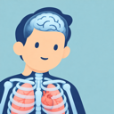

**English** | [中文](README.zh-CN.md)

<p align="center">
  
</p>
<h1 align="center">BodyVista</h1>

<p align="center">
  <a href="https://freedomintelligence.github.io/BodyVista/">🌐 Live Demo</a>
  ·
  <a href="https://huggingface.co/spaces/FreedomIntelligence/BodyVista">🤗 Hugging Face Space</a>
</p>

<p align="center">
  
</p>


**From human anatomy to physiology—observe, interact with, and explore the human body.**

`BodyVista` is a 3D interactive platform for anatomy and physiology education and self-directed learning. It brings **2,900 anatomical structures, 12 body systems, 140 dynamic demonstration entries, and 6 microscopic topics** into the browser, helping learners understand spatial relationships, anatomical layers, and physiological functions.

Available in **Chinese, English, and Japanese**, with desktop and mobile layouts. Core interactions run locally in the browser, requiring no self-hosted backend or database. The site can be deployed to GitHub Pages.

## ✨ Features

| Module | Features and learning value |
| --- | --- |
| Human Anatomy | Explore 2,900 structures by system and 7 major body regions. Use selection, progressive hiding, multiple selection, transparency, and structure focusing to examine neighboring structures and anatomical layers. |
| Life in Motion | Access 133 system demonstrations, 5 whole-body demonstrations, and 2 oral and dental demonstrations to connect anatomy with function. Includes playback, progress, and speed controls. |
| Microscopic Exploration | Explore 6 topics: alveolar gas exchange, the nephron, sarcomere contraction, neural synapses, intestinal villi, and the vessel wall, connecting organs with microscopic mechanisms. |
| Anatomy Challenge | Practice structure identification, finding structures in 3D, and microscopic knowledge questions. Each round contains 5 questions, with answer feedback, results, and options to try again. |

Additional features:

- **3D navigation and sectioning**: Rotate, pan, zoom, reset the view, switch between perspective and orthographic projection, and examine transverse, sagittal, and coronal sections.
- **Drawing and measurement**: Adjustable brush size, an eraser, structure labels, and measurement tools support classroom demonstrations and independent exploration.
- **Structure knowledge and search**: Find structures by name and view explanations, related structures, and references. Dental structures include FDI tooth numbers and tissue descriptions.
- **AI-assisted further learning**: Open ChatGPT or DeepSeek with a prompt based on the current structure and selected language. These are external links; no API key is required in the project.
- **Multilingual, responsive layouts**: Chinese, English, and Japanese interfaces and educational content, with desktop sidebars and collapsible mobile menus.

This project is intended for teaching and learning. Animations, microscopic scenes, and some oral structures include schematic representations and are not intended for clinical diagnosis or treatment decisions.

## 🛠️ Technology Stack

| Layer | Technology |
| --- | --- |
| Main interface | JavaScript ES Modules, HTML, CSS |
| 3D rendering | Three.js, WebGL, GLTFLoader |
| Oral module | TypeScript, Three.js, three-mesh-bvh; integrated upstream modules use Zustand and include React dependencies |
| Data and localization | Local JSON data, dictionaries for three languages, and translation coverage checks |
| Build | Vite 7, npm |
| Testing | Node.js built-in test runner |
| Deployment | GitHub Actions, GitHub Pages |

## Muscle Motion

Choose **Muscle Motion** in the atlas navigation and browse 50 verified movements in seven categories, including six dumbbell exercises. Each verified movement includes anatomical surfaces, muscle tensions, joint torques and external support. The full-body model reports 740 musculotendon units per valid frame. [Open the online motion library](https://freedomintelligence.github.io/BodyVista/?workspace=muscle-motion)

**Install the offline edition to design movements and calculate their forces. Custom motion editing is still in development.** The editor uses the same BodyVista navigation as the online player. It supports keyframes, timing, load, support and JSON scene import/export. On Windows, clone tag `v1.2.0` with `core.autocrlf=false`, install the pinned Python 3.13 dependencies and run `python tools/install-motion-lab.py --download`. Build the frontend with `npm ci` and `npm run build`, then run `experiments/elbow-lab/server.py --port 4192` with that Python environment. [Installation steps](docs/OFFLINE_MOTION.md) · [Open the installed editor](http://127.0.0.1:4192/?workspace=muscle-motion) · [Full-body model](experiments/body-lab/FULLBODY.md)

Two hand-authored scenes provide starting points for the offline editor. Both files contain motion inputs. Import one using the motion file menu, then calculate its forces. [Right wrist and fist](experiments/body-lab/examples/custom_right_rotate_bend_make_fist.json) · [Left hand and forearm](experiments/body-lab/examples/custom_left_open_while_rotating.json)


The v5 model applies measured deep flexor moment arms to three joints of each little finger. Eight existing flexor digitorum superficialis (FDS) units use a passive fibre and tendon in series. The middle finger retains its native path geometry. The Thelen tendon curve uses 0.04 strain at maximum isometric force. The model uses 24 finger coordinates to check passive reference torques. [Franko et al., Table 2](https://pmc.ncbi.nlm.nih.gov/articles/PMC3124620/) · [OpenSim 4.6 Thelen defaults](https://github.com/opensim-org/opensim-core/blob/4.6/OpenSim/Actuators/Thelen2003Muscle.cpp#L165-L171). All 740 units participate in whole-body recruitment. The muscle tensions and contact forces shown during playback are estimates for the chosen motion and constraints. The published moment arms used by the model are measurements of geometry, not direct measurements of these simulated forces. Finger–dumbbell forces depend on modeled contact geometry and friction, and muscle tensions are model estimates. Individual human muscle forces, cartilage pressure and ligament contact forces have not been validated by this experiment. [Model scope and sources](experiments/body-lab/FULLBODY.md)

## 🚀 Getting Started

### Local Development

Install **Node.js 22.12 or later** and npm:

```bash
git clone https://github.com/FreedomIntelligence/BodyVista.git
cd BodyVista
npm ci
npm run dev
```

Open the local URL printed in the terminal. The source entry point must be served through Vite; do not open `index.html` directly from the filesystem.

### Testing and Building

```bash
npm test
npm run build
npm run preview
```

`npm run build` checks translation and oral module content coverage before generating the site in `dist/`. Use `npm run preview` to preview the production build locally.

Models and thumbnails are included in the repository, so cloning and initial loading may take some time. Keep `assets/`, `thumbs/`, and `dental/models/` in place.

### GitHub Pages Deployment

The repository deploys automatically through [GitHub Actions](.github/workflows/pages.yml). In **Settings → Pages → Build and deployment**, set **Source** to **GitHub Actions**.

Every push to `main` installs locked dependencies with Node.js 22, runs tests and content checks, builds the website and model assets, and publishes `dist/`. You can also deploy manually from **Actions → Deploy BodyVista to GitHub Pages → Run workflow**.

## 🌱 Our Vision

We hope BodyVista can make learning about the human body more accessible, offering intuitive resources for science outreach and education in low-resource regions. We also aim to bring related research into **immersive VR and AR experiences**, enabling learners to observe, interact with, and explore human anatomy and physiology.

## 🙏 Acknowledgements

We thank the following projects, authors, and institutions for their resources and foundational work:

- **Z-Anatomy, Lluís Vinent, and contributors**: Human anatomy models and related data. Per-structure provenance is recorded in the `source_attribution` fields of [`catalog.json`](catalog.json).
- **BodyParts3D / The Database Center for Life Science (DBCLS)**: Foundational resources for human anatomy and oral models.
- **Dental Scope, Yoseph, and contributors**: The oral engine, anatomical registry, educational content, and models. See the [integration notes](dental/README.md), original [CREDITS](dental/vendor/CREDITS.md), and [asset provenance documentation](dental/vendor/docs/assets.md) for attribution and modification records.
- **OpenStax, Anatomy and Physiology 2e**: Educational references for anatomical knowledge and physiology topics. Links to specific chapters are retained in the relevant content data.
- **Three.js, Vite, three-mesh-bvh, Zustand, React**, and their contributors: Rendering, build tooling, and oral module dependencies.

Preserve the provenance and licenses of individual third-party resources. BodyVista attribution does not replace attribution to the original authors.

## 👥 Contributors

<table>
  <tr>
    <td align="center">
      <a href="https://github.com/MarkMaMed">
        <br>
        <sub><b>MarkMaMed</b></sub>
      </a>
    </td>
    <td align="center">
      <a href="https://github.com/rikka314">
        <br>
        <sub><b>rikka314</b></sub>
      </a>
    </td>
    <td align="center">
      <a href="https://github.com/WangRongsheng">
        <br>
        <sub><b>WangRongsheng</b></sub>
      </a>
    </td>
  </tr>
</table>

Issues and pull requests are welcome. Run `npm test` and `npm run build` before submitting changes. Add Chinese, English, and Japanese translations for new visible text. Include verifiable references when changing anatomical or physiological content.

## 📄 Licence

© 2026 FreedomAI

BodyVista's own code is licensed under the **[MIT License](LICENSE)**. This does not change the licenses of third-party code, models, or adapted educational content. See [Third-Party Notices](THIRD_PARTY_NOTICES.md).

Third-party code, models, and educational content retain their respective licenses:

- **Dental Scope code**: MIT; see [`dental/vendor/LICENSE`](dental/vendor/LICENSE). That file also describes the separate licensing of models and educational content.
- **Oral models and adapted educational content**: Refer to the individual records in [CREDITS](dental/vendor/CREDITS.md), the [asset provenance documentation](dental/vendor/docs/assets.md), and the [integration notes](dental/README.md). These include resources under CC BY-SA 2.1 Japan and CC BY-SA 4.0.
- **Main application anatomy models**: Consult the per-structure provenance records in `catalog.json`. Some records currently contain the marker `NC exceptions; research only`. Their provenance and permitted scope of public distribution remain to be verified; these records should not be treated as a uniform license without additional restrictions.
- **Other third-party libraries**: Retain their respective licenses and copyright notices.

The MIT grant covers only code and documentation that we have the right to release under that license. It excludes third-party models and separately licensed content.
